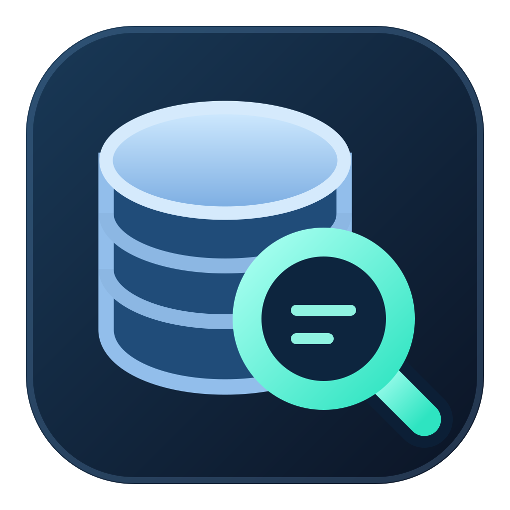
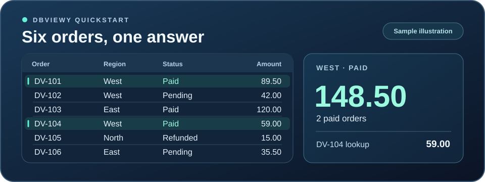

<p align="center">
  
</p>

<h1 align="center">DBviewy</h1>

<p align="center"><strong>Open, search and edit tables on your desktop.</strong></p>

<p align="center">
  <a href="#try-it-with-six-orders">Quickstart</a> ·
  <a href="#build-from-source">Build from source</a> ·
  <a href="#workbook-safety">Workbook safety</a> ·
  <a href="CHANGELOG.md">Changelog</a> ·
  <a href="LICENSE">MIT license</a>
</p>

DBviewy is a native fork of [Octa](https://github.com/thorstenfoltz/octa), based
on Octa 0.22.1. Open an Excel workbook, CSV file, SQLite database or Parquet
file and work with it in a tabbed grid. Run DuckDB SQL on open tables without
moving them to another app.

## Try it with six orders



<!-- dbviewy-quickstart -->

Open the [six-order CSV](samples/features/dbviewy-orders.csv). Double-click
a cell in the **result** column, enter the formula and press **Enter**.
Row numbers start below the header. The first result cell is `E1`.

| Enter in | Formula | Expected number |
| --- | --- | --- |
| `E1` | `=SUMIFS(D1:D6,B1:B6,"West",C1:C6,"Paid")` | 148.50 |
| `E2` | `=COUNTIFS(B1:B6,"West",C1:C6,"Paid")` | 2 |
| `E3` | `=XLOOKUP("DV-104",A1:A6,D1:D6,-1)` | 59.00 |

Choose **File → Save as…** and give the new file an `.xlsx` extension.
The three results are saved as numbers. The original CSV stays unchanged.
See the [formula guide](docs/usage/formulas.md) for range rules, fixed
references and the German function names.

You can get the same paid total from the original CSV without opening
the desktop app. Run this from the repository root:

```sh
cargo run --release --locked --bin octa -- \
  --sql samples/features/dbviewy-orders.csv -f json \
  -q "SELECT CAST(SUM(amount) AS DOUBLE) AS paid_west FROM data WHERE region = 'West' AND status = 'Paid'"
```

<!-- /dbviewy-quickstart -->

The query returns `[{"paid_west":148.5}]`. The quickstart is checked by
[automated tests](tests/dbviewy_quickstart.rs); see the separate
[50-workflow test catalog](tests/dbviewy_workflows/README.md) for local
databases, file formats, formulas, SQL and CLI examples.

## What DBviewy adds

| Workflow | How it works |
| --- | --- |
| **Find rows while you type** | Press `Ctrl+F` to focus instant search. Use the options menu to switch between Filter and Highlight, or limit the search to a column. `Esc` clears the query. |
| **Edit from the grid or ribbon** | Enter a cell address in the name box to jump there. Use the formula bar to edit the selected cell, or collapse the ribbon for more table space. |
| **Work across sheets and tables** | Open workbooks from Finder on macOS. Choose an individual sheet or database table, or open all tables from a local SQLite or DuckDB database. Opening all tables loads them into memory. |
| **Restore columns one at a time** | Reopen a folded column from its header without restoring the other folded columns. |
| **Keep pictures with the data** | Store thumbnails in a portable SQLite catalogue and browse them without a separate image folder. |
| **Ask with text or voice** | Smartchat uses the same draft as the assistant panel. DBviewy adds a SYC Free profile and optional local Parakeet dictation. |

The grid, SQL, file readers, database and cloud connectors, charts, CLI and MCP
server come from Octa. See the [upstream guide](https://thorstenfoltz.github.io/octa/)
for their documentation. Upstream downloads install **Octa**, not DBviewy.

## Workbook safety

For supported cell-value edits to an existing `.xlsx` file, DBviewy patches
the worksheet in the original workbook. Existing text, numbers and
booleans can be replaced or cleared without removing the cell's style.
Other sheets, formulas and filters stay in place. Excel may recalculate
formulas after reopening; DBviewy does not recalculate the whole workbook.

Clearing a cell is not secure redaction. Shared strings and cached
formula results elsewhere in the file may retain the old value.

Unsupported edits, such as changes to formula cells or the workbook structure,
are refused by this save path. Use a separate export when you need a different
table or file format. A filtered table export is not a copy of the full
workbook.

## Build from source

You need Git LFS for the bundled fonts and data, and Rust via
[rustup](https://rustup.rs/). See Octa's
[platform dependencies](https://thorstenfoltz.github.io/octa/getting-started/installation/)
for macOS, Windows and Linux.

```sh
git clone https://github.com/Supersynergy/DBviewy.git
cd DBviewy
git lfs pull
cargo run --release --locked --bin octa
```

To open a file directly, append `-- path/to/file.xlsx` to the last command.
The binary is still named `octa` for compatibility.

For changes in this fork, see the [changelog](CHANGELOG.md). For the original
project and contributors, see [Octa on GitHub](https://github.com/thorstenfoltz/octa)
and the [notices](NOTICE).
